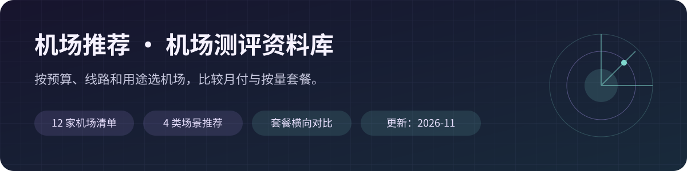

# 2026 机场推荐与机场测评｜12家机场清单、套餐价格与选购指南 | Clash / v2ray 稳定真实评测

2026 年流行的翻墙机场推荐，机场梯子适合已经翻墙很久，掌握了一些翻墙知识的同学。机场一般采用专用的翻墙协议，如 Shadowsocks、ShadowsocksR、V2ray（Vmess）、Trojan 等， 适配于 Clash、Shadowrocket、Quantumult X、Stash、Surge、V2rayN、Surfboard 等多种客户端。翻墙机场不是VPN，但胜过VPN。

  <picture>
    
  </picture>

<strong>更新：2026-11</strong> · 收录12家机场 · 月付与按量套餐对比

这份**机场推荐**整理Flybit、西游云、CocoDuck、星辰云等12家机场，围绕月付价格、按量流量、设备限制、专线权限、家宽落地和客户端要求做对比。每家**机场测评**包含选购分析、代表套餐和已收录套餐清单，方便你先按预算与使用频率筛选，再核对自己关心的配置。

**先选场景，再看套餐。** 下方省流中的多家机场是备选，重复出现在不同分类不表示需要重复购买。线路和平台支持按现有资料描述，测评范围见[资料说明](docs/methodology.md)。

[⚡ 省流推荐](#quick-picks) · [🏆 完整机场清单](#ranking) · [📖 逐家机场测评](#reviews) · [🧩 选购指南](#guides) · [❓ 选购问答](#faq)

[🧭 新手选购流程](#buying-roadmap) · [💰 预算与付款对比](#budget-comparison) · [📱 客户端与设备](#device-client-guide) · [🔤 线路术语](#route-glossary) · [🛠️ 连接问题排查](#connection-troubleshooting)

## ⚡ 省流机场推荐｜按自己的需求选一家

| 需求 | 备选机场 · 点击看详情 | 先看的套餐 | 选择理由 |
|---|---|---|---|
| 🚀 性价比 | [Flybit](#flybit) | ¥15/月 · 128GB | IEPL标注、不限设备，日常专线方向 |
| 🚀 性价比 | [西游云](#xiyou) | ¥9/月 · 120GB；¥16/月 · 200GB | 预算优先看9元，专线权限看16元 |
| 🍜 便宜量大 | [西游云](#xiyou) | ¥9/月 · 120GB | 5台设备；16元200GB档标注精品IEPL |
| 🍜 便宜量大 | [星辰云（星辰机场）](#xingchen-cloud) | ¥8/月 · 80GB；¥9.9/月 · 100GB | 8元档限2台且无客服；17元200GB档标注IEPL |
| 💎 高端 | [CocoDuck](#cocoduck) | ¥17/月 · 100GB | 家宽落地方向；常规套餐标注全部节点、不限设备 |
| 💎 高端 | [WgetCloud](#wgetcloud) | ¥99/月 · 230GB | 老牌高端专线方向；留意在线IP、连接数和节点分层 |
| 🎒 按量付费 | [Flybit](#flybit) | ¥36/次 · 128GB；¥68/次 · 256GB | IEPL标注、按总量使用，适合不固定使用频率 |

**想进一步比较：** [性价比机场推荐](docs/recommendation-value.md) · [便宜量大机场推荐](docs/recommendation-budget.md) · [高端机场推荐](docs/recommendation-premium.md) · [按量付费机场推荐](docs/recommendation-pay-as-you-go.md)

## 🏆 完整机场推荐清单｜本篇12家顺序

| 顺位 | 机场 · 查看测评 | 月付起步参考 | 按量常规起步 | 选择重点 |
|:---:|---|---|---|---|
| 1 | [Flybit](#flybit) | ¥15/月 · 128GB/月 | ¥36/次 · 128GB不限时 | IEPL资料标注 · 多设备 · 月付与不限时 |
| 2 | [西游云](#xiyou) | ¥9/月 · 120GB/月 | ¥98/次 · 300GB总量 | 低月费 · 大流量 · 分档专线 |
| 3 | [CocoDuck](#cocoduck) | ¥17/月 · 100GB/月 | 未收录明确价格 | 家宽落地方向 · 全部节点 · 不限设备 |
| 4 | [星辰云（星辰机场）](#xingchen-cloud) | ¥8/月 · 80GB/月 | ¥98/次 · 300GB不限时 | 低价大流量 · 17元IEPL · 多种周期 |
| 5 | [飞鸟加速](#feiniao-speed) | ¥15/月 · 150GB/月 | ¥99/次 · 300GB总量，不限时 | 跨境专线标注 · 多设备 · 月付与不限时 |
| 6 | [飞鸟云](#feiniaoyun) | ¥10/月 · 200GB/月 | ¥10/次 · 200GB总量，用完为止 | 低价按量 · Hysteria2 · 需自行配置IPv6 |
| 7 | [秒秒云](#miaomiao-cloud) | ¥14/月 · 128GB/月 | ¥99/次 · 100GB用完为止 | 中转节点 · 月付与备用 · 分档设备数量 |
| 8 | [WgetCloud](#wgetcloud) | ¥99/月 · 230GB/月，30天重置 | 未收录明确价格 | 高端专线方向 · 在线IP限制 · 价格较高 |
| 9 | [极速云](#jisu-cloud) | ¥15.99/月 · 1200GB标称/月，按6倍约200GB可传输/月 | ¥88/次 · 1000GB标称总量，按6倍约166.7GB可传输总量 | 标称大额度 · 6倍倍率 · 分档设备限制 |
| 10 | [魔戒机场](#mojie) | 未收录月付 | ¥19.9/次 · 130GB用完为止 | 按量不限时 · 无倍率标注 · 小额备用 |
| 11 | [大哥云](#dage-cloud) | ¥19.9/月 · 100GB/月（按自然月） | 未收录明确价格 | Trojan · 周期套餐 · 分档流量 |
| 12 | [扬帆云](#yangfanyun) | ¥19.99/月 · 100GB/周期 | 未收录明确价格 | V2Ray通用订阅 · 分档专线 · 设备数量明确 |

> 🔐 保存账号、密码、绑定邮箱、订单和官方通知渠道。机场域名变动时，能更快找回原账号，也避免错过老客优惠。

顺序是本篇的推荐安排，按维护者指定，不是统一网络环境下的测速排名，也不改变其他版本或主网站榜单。

**横向比较：** [月付机场价格表](docs/compare-monthly-price.md) · [按量与不限时套餐表](docs/compare-pay-as-you-go.md) · [设备与线路权限表](docs/compare-devices-and-routes.md)

## 📖 机场测评与代表套餐

## 🚀 01. Flybit机场测评｜15元IEPL，月付与按量都能选

  <picture>
    <source type="image/webp" srcset="images/webp/01-flybit-Flybit.webp">
    
  </picture>

Flybit提供128GB至512GB月付，以及128GB至1024GB不限时流量包。套餐标注IEPL专线、不限设备，适合希望把月费、线路和使用频率一起比较的用户。

## [👉 点击进入官网](https://goflybit.com/register?code=m4qRDLA1)

**适合人群：** 日常手机、电脑多设备使用，以及需要按量流量备用的用户。

**选购建议：** 主用先看15元128GB月付；偶尔使用先比较36元128GB不限时。用量稳定后，再考虑256GB或512GB档。

| 代表方案 | 价格与周期 | 流量 | 推荐指数 |
|---|---:|---|:---:|
| 每月-128G | ¥15/月 | 128GB/月 | ⭐⭐⭐⭐⭐ |
| 每月-192G | ¥22/月 | 192GB/月 | ⭐⭐⭐⭐⭐ |
| 每月-256G | ¥28/月 | 256GB/月 | ⭐⭐⭐⭐⭐ |
| 每月-512G | ¥52/月 | 512GB/月 | ⭐⭐⭐⭐⭐ |
| 不限时-128G | ¥36/次 | 128GB不限时 | ⭐⭐⭐⭐⭐ |
| 不限时-256G | ¥68/次 | 256GB不限时 | ⭐⭐⭐⭐ |
| 不限时-512G | ¥128/次 | 512GB不限时 | ⭐⭐⭐⭐ |
| 不限时-1024G | ¥238/次 | 1024GB不限时 | ⭐⭐⭐⭐ |

**套餐比较补充：** 把15元128GB月付与36元128GB不限时分开看：前者适合每月持续用，后者适合间隔较长的使用节奏。升到22元192GB或28元256GB时，主要按实际月用量决定；不要因为不限时有效期长，就忽略总流量可能不足。

**购买前看一眼：** 确认常用地区、协议和客户端能否配合使用。

[📖 查看Flybit完整机场测评、套餐与注意事项](docs/airport-flybit.md) · [返回完整榜单](#ranking)

---

## 🍜 02. 西游云机场测评｜9元120GB起，16元档再看精品专线

  <picture>
    <source type="image/webp" srcset="images/webp/02-xiyou-西游云.webp">
    
  </picture>

西游云适合预算优先的日常使用：9元轻量型提供120GB/月，16元标准型增加流量、设备数量和精品专线权限，也有一次性不限时包。

## [👉 点击进入官网](https://e.xiyou666.xyz/?code=s7S4hVxm)

**适合人群：** 月度预算较低，或希望从普通月付升级到精品专线的用户。

**选购建议：** 先比较9元120GB和16元200GB。轻量型月付不含高速精品专线；在意专线和家宽资料时，重点核对标准型。

| 代表方案 | 价格与周期 | 流量 | 推荐指数 |
|---|---:|---|:---:|
| 轻量型 | ¥9/月 | 120GB/月 | ⭐⭐⭐⭐⭐ |
| 标准型 | ¥16/月 | 200GB/月 | ⭐⭐⭐⭐⭐ |
| 高能型 | ¥38/月 | 500GB/月 | ⭐⭐⭐⭐⭐ |
| 标准型不限时 | ¥98/次 | 300GB总量 | ⭐⭐⭐⭐⭐ |
| 高能型不限时 | ¥159/次 | 600GB总量 | ⭐⭐⭐⭐ |
| 轻量型（年付） | ¥90/年 | 120GB/月，共12个月 | ⭐⭐ |
| 高能型（年付） | ¥290/年 | 500GB/月，共12个月 | ⭐⭐ |

**套餐比较补充：** 9元到16元的差额不仅增加80GB月流量，也从5台设备变为8台，并改变精品专线权限。每月120GB已经够用且不需要这些配置时，可先看轻量型；需要更多设备或高档节点，再比较标准型。年付轻量型与月付权限不同，逐项核对。

**购买前看一眼：** 同名轻量型月付与年付的节点权限不同。

[📖 查看西游云完整机场测评、套餐与注意事项](docs/airport-xiyou.md) · [返回完整榜单](#ranking)

---

## 🦆 03. CocoDuck机场测评｜家宽落地与节点配置方向

  <picture>
    <source type="image/webp" srcset="images/webp/03-cocoduck-CocoDuck.webp">
    
  </picture>

CocoDuck常规套餐17元/月100GB起，商店标注开放全部节点、不限连接速度和设备数量。来源资料提及海外团队、BGP中转与家宽落地，适合更关注节点配置的人。

## [👉 点击进入官网](https://www.cocoduck.site/auth/register?code=e2c254b876)

**适合人群：** 希望比较家宽落地、AI与流媒体需求，并关注多设备使用的用户。

**选购建议：** 从17元100GB或31元200GB常规月付开始比较。77元迷你鸭是全年总价、每月40GB；加油包必须搭配常规套餐。

| 代表方案 | 价格与周期 | 流量 | 推荐指数 |
|---|---:|---|:---:|
| 个人套餐 | ¥17/月 | 100GB/月 | ⭐⭐⭐⭐⭐ |
| 精英套餐 | ¥31/月 | 200GB/月 | ⭐⭐⭐⭐⭐ |
| 家庭套餐 | ¥75/月 | 500GB/月 | ⭐⭐⭐⭐⭐ |
| 团队套餐 | ¥115/月 | 1000GB/月 | ⭐⭐⭐⭐⭐ |
| 迷你鸭77 | ¥77/年 | 40GB/月，共12个月 | ⭐⭐ |

**套餐比较补充：** 个人、精英、家庭、团队四档主要按月流量区分，选择100GB、200GB或更高档前，先估算自己的用量。77元迷你鸭是年付40GB/月，适合轻量需求；配套加油包不是独立不限时订阅，不用它来填补按量套餐。

**购买前看一眼：** 家宽、地区与平台支持按具体节点核对。

[📖 查看CocoDuck完整机场测评、套餐与注意事项](docs/airport-cocoduck.md) · [返回完整榜单](#ranking)

---

## ✨ 04. 星辰云（星辰机场）机场测评｜8元入门，重点比较9.9元与17元档

  <picture>
    <source type="image/webp" srcset="images/webp/04-xingchen-星辰云.webp">
    
  </picture>

星辰云提供月付、季付、半年付、年付与不限时包。最低8元80GB月付限2台设备；日常更推荐比较9.9元100GB或17元200GB标准版，后者标注IEPL、原生IP与家宽IP。

## [👉 点击进入官网](https://xc1.luniu8.com/?code=det68imC)

**适合人群：** 需要低价月付，或希望用17元左右预算比较家宽与IEPL资料的用户。

**选购建议：** 单设备轻量用途可看8元档；更常用优先比较9.9元入门版。关心IEPL与家宽时看17元标准版，不把低价档默认当作专线档。

| 代表方案 | 价格与周期 | 流量 | 推荐指数 |
|---|---:|---|:---:|
| 初级版 | ¥8/月 | 80GB/月 | ⭐⭐⭐⭐⭐ |
| 入门版 | ¥9.9/月 | 100GB/月 | ⭐⭐⭐⭐⭐ |
| 标准版 | ¥17/月 | 200GB/月 | ⭐⭐⭐⭐⭐ |
| VIP版 | ¥30/月 | 450GB/月 | ⭐⭐⭐⭐⭐ |
| 不限时流量-B版 | ¥98/次 | 300GB不限时 | ⭐⭐⭐⭐⭐ |
| 不限时流量-C版 | ¥199/次 | 1000GB不限时 | ⭐⭐⭐⭐ |
| 标准版（季度） | ¥48/季 | 200GB/月 | ⭐⭐⭐⭐ |
| 入门版（年付） | ¥99/年 | 100GB/月 | ⭐⭐ |

**套餐比较补充：** 日常选择可以先比较9.9元100GB与17元200GB，两档每月相差7.1元，但差别同时包含流量和高端节点资料。8元档虽然付款门槛更低，却有设备和客服限制。季付48元是整个季度总价，不是单月价格。

**购买前看一眼：** 8元初级版限2台设备且不提供客服支持。

[📖 查看星辰云（星辰机场）完整机场测评、套餐与注意事项](docs/airport-xingchen-cloud.md) · [返回完整榜单](#ranking)

---

## 🪽 05. 飞鸟加速机场测评｜15元150GB，跨境专线资料标注

  <picture>
    <source type="image/webp" srcset="images/webp/05-feiniao-speed-飞鸟加速.webp">
    
  </picture>

飞鸟加速提供四档月付与两档不限时包，15元/月150GB起。商店标注跨境高速专线、多设备同时使用，适合先按月度额度选择，再比较备用流量的人。

## [👉 点击进入官网](https://www.112112789.xyz/?code=n1zhm5HP)

**适合人群：** 需要约150GB起月度流量，或希望手机、电脑切换使用的用户。

**选购建议：** 主用从15元150GB开始看；流量较多再比较25元260GB、35元370GB。备用可看99元300GB一次性包。

| 代表方案 | 价格与周期 | 流量 | 推荐指数 |
|---|---:|---|:---:|
| 基础版-县令 | ¥15/月 | 150GB/月 | ⭐⭐⭐⭐⭐ |
| 进阶版-知府 | ¥25/月 | 260GB/月 | ⭐⭐⭐⭐⭐ |
| 高阶版-巡抚 | ¥35/月 | 370GB/月 | ⭐⭐⭐⭐⭐ |
| 专业版-总督 | ¥45/月 | 480GB/月 | ⭐⭐⭐⭐⭐ |
| 畅想流量包--300G | ¥99/次 | 300GB总量，不限时 | ⭐⭐⭐⭐⭐ |
| 畅想流量包--800G | ¥199/次 | 800GB总量，不限时 | ⭐⭐⭐⭐ |

**套餐比较补充：** 从15元150GB到25元260GB，适合根据自己每月是否经常超额判断；再高的35元、45元档也按同样方式看。99元300GB与199元800GB是固定总量的备用方案，不会每月再发相同额度。现有资料没有明确年付结算价，因此没有补写年付金额。

**购买前看一眼：** 多设备使用未提供数量上限，不等于无限设备或允许共享。

[📖 查看飞鸟加速完整机场测评、套餐与注意事项](docs/airport-feiniao-speed.md) · [返回完整榜单](#ranking)

---

## 🪶 06. 飞鸟云机场测评｜10元200GB按量包，先确认IPv6配置

  <picture>
    <source type="image/webp" srcset="images/webp/06-feiniaoyun-飞鸟云.webp">
    
  </picture>

飞鸟云收录月付、年付与按量不限时方案。常规不限时包10元200GB起，资料对应Hysteria2并要求自行配置IPv6，适合愿意阅读教程和处理客户端配置的用户。

## [👉 点击进入官网](https://feiniaoyun.xyz/#/register?code=F1BcowUV)

**适合人群：** 有配置经验，希望小额购买按量流量作为备用的用户。

**选购建议：** 按量先比较10元200GB和15元400GB。月付与不限时可能有相同价格和额度数字，但发放方式不同；先确认网络能完成IPv6配置。

| 代表方案 | 价格与周期 | 流量 | 推荐指数 |
|---|---:|---|:---:|
| 月付200G | ¥10/月 | 200GB/月 | ⭐⭐⭐⭐⭐ |
| 月付400G | ¥15/月 | 400GB/月 | ⭐⭐⭐⭐⭐ |
| 月付600G | ¥20/月 | 600GB/月 | ⭐⭐⭐⭐⭐ |
| 不限时200G | ¥10/次 | 200GB总量，用完为止 | ⭐⭐⭐⭐⭐ |
| 不限时400G | ¥15/次 | 400GB总量，用完为止 | ⭐⭐⭐⭐ |
| 不限时600G | ¥20/次 | 600GB总量，用完为止 | ⭐⭐⭐⭐ |
| 传家宝 | ¥12/年 | 50GB/月，共12个月 | ⭐⭐ |
| 传家宝加大版 | ¥24/年 | 100GB/月，共12个月 | ⭐⭐ |

**套餐比较补充：** 10元200GB月付与10元200GB不限时虽然价格和数字相同，前者按月度额度使用，后者按总量使用，续费频率会不同。12元、24元传家宝档是全年付款，月流量分别为50GB、100GB。先解决IPv6与客户端配置，再决定选择哪种付款方式。

**购买前看一眼：** 现有资料注明购买后不退款。

[📖 查看飞鸟云完整机场测评、套餐与注意事项](docs/airport-feiniaoyun.md) · [返回完整榜单](#ranking)

---

## ⏱️ 07. 秒秒云机场测评｜14元128GB，按设备数量逐档选

  <picture>
    <source type="image/webp" srcset="images/webp/07-miaomiao-秒秒云.webp">
    
  </picture>

秒秒云提供四档常规月付、年付特惠和不限时包，14元/月128GB支持3台设备。商店标注中转高速节点、流媒体与GPT支持，设备数量随档位变化。

## [👉 点击进入官网](https://dl2.mmy8.com/#/register?code=dUjEJXLh)

**适合人群：** 月度流量较固定，希望把同时在线设备数量一起算清楚的用户。

**选购建议：** 日常先比较14元128GB与26元256GB。79元特惠为年付总价、每月68GB，不能与14元月付按同一种付款周期比较。

| 代表方案 | 价格与周期 | 流量 | 推荐指数 |
|---|---:|---|:---:|
| 128G/月-探花 | ¥14/月 | 128GB/月 | ⭐⭐⭐⭐⭐ |
| 256G/月-榜眼 | ¥26/月 | 256GB/月 | ⭐⭐⭐⭐⭐ |
| 512G/月-状元 | ¥49/月 | 512GB/月 | ⭐⭐⭐⭐⭐ |
| 1024G/月-大学士 | ¥98/月 | 1024GB/月 | ⭐⭐⭐⭐⭐ |
| 不限时间100G | ¥99/次 | 100GB用完为止 | ⭐⭐⭐⭐⭐ |
| 不限时间300G | ¥268/次 | 300GB用完为止 | ⭐⭐⭐⭐ |
| 68G/特惠套餐 | ¥79/年 | 68GB/月 | ⭐⭐ |
| 200G/特惠套餐 | ¥170/年 | 200GB/月 | ⭐⭐ |

**套餐比较补充：** 14元探花与26元榜眼的月流量从128GB增加到256GB，同时在线设备从3台增加到6台。需要更多设备时，这个差别可能比单纯每GB价格更重要。79元68GB特惠是年付总价，不把它当作能单月购买的低价档。

**购买前看一眼：** 已收录套餐均注明特殊商品不退款。

[📖 查看秒秒云完整机场测评、套餐与注意事项](docs/airport-miaomiao-cloud.md) · [返回完整榜单](#ranking)

---

## 💎 08. WgetCloud机场测评｜老牌高端方向，99元月付起

  <picture>
    <source type="image/webp" srcset="images/webp/08-wgetcloud-WgetCloud.webp">
    
  </picture>

WgetCloud属于老牌高端机场方向，价格明显高于低价方案。个人月付99元起，档位在流量、速率、节点权限、在线IP与连接数上有区别，适合预算充足且重视这些配置的用户。

## [👉 点击进入官网](https://invite.wgetcloud.ltd/auth/register?code=fZ0Rsm)

**适合人群：** 预算充足，愿意为专线、节点权限与服务配置支付更高月费的用户。

**选购建议：** 先比较99元基础、109元优质与119元精品月付。团队年付预付金额很高，先按授权用途和在线IP规则核对，避免把团队名称当作可任意共享。

| 代表方案 | 价格与周期 | 流量 | 推荐指数 |
|---|---:|---|:---:|
| 基础专线服务 | ¥99/月 | 230GB/月，30天重置 | ⭐⭐⭐⭐⭐ |
| 优质专线服务 | ¥109/月 | 250GB/月，30天重置 | ⭐⭐⭐⭐⭐ |
| 精品专线服务 | ¥119/月 | 270GB/月，30天重置 | ⭐⭐⭐⭐⭐ |
| 精品团队套餐-M | ¥10464/年 | 2880GB/月，30天重置 | ⭐⭐ |
| 精品团队套餐-L | ¥15200/年 | 5760GB/月，30天重置 | ⭐⭐ |

**套餐比较补充：** 99元基础、109元优质、119元精品的差别不只在230GB至270GB的月流量，还包含节点等级、速率、在线IP和连接数。表中的万元级金额是团队年付方案，不能作为个人月付理解；团队授权与禁止共享规则应另行确认。

**购买前看一眼：** 资料标注禁止多人共享且新疆地区不可用，团队授权规则需单独确认。

[📖 查看WgetCloud完整机场测评、套餐与注意事项](docs/airport-wgetcloud.md) · [返回完整榜单](#ranking)

---

## 🍃 09. 极速云机场测评｜看标称额度，也要计算6倍倍率

  <picture>
    <source type="image/webp" srcset="images/webp/09-jisu-极速云.webp">
    
  </picture>

极速云已有代表月付方案从15.99元起，标称1200GB。资料标注6倍倍率时，实际可传输量约为200GB，因此要把倍率、设备数量和付款周期放在一起比较。

## [👉 点击进入官网](https://qa.slnioaykrfm.com:8888/#/register?code=y739TBai)

**适合人群：** 能理解流量倍率，愿意先计算可传输流量再选套餐的用户。

**选购建议：** 15.99元1200GB按6倍折合约200GB/月、3台设备；22元1800GB折合约300GB/月、5台设备。选择当前节点时仍要看实时倍率。

| 代表方案 | 价格与周期 | 流量 | 推荐指数 |
|---|---:|---|:---:|
| 月付1200G | ¥15.99/月 | 1200GB标称/月，按6倍约200GB可传输/月 | ⭐⭐⭐⭐⭐ |
| 月付1800G | ¥22/月 | 1800GB标称/月，按6倍约300GB可传输/月 | ⭐⭐⭐⭐⭐ |
| 月付3500G | ¥39.99/月 | 3500GB标称/月，按6倍约583.3GB可传输/月 | ⭐⭐⭐⭐⭐ |
| 不限时1000G | ¥88/次 | 1000GB标称总量，按6倍约166.7GB可传输总量 | ⭐⭐⭐⭐⭐ |
| 年付1500G | ¥150/年 | 1500GB标称/月，共12个月，按6倍约250GB可传输/月 | ⭐⭐ |

**套餐比较补充：** 15.99元1200GB与22元1800GB应先按已有6倍倍率折成约200GB和300GB可传输流量，再与其他机场比较。88元不限时1000GB同样是标称总量，折合约166.7GB。年付和不限时的额度发放方式不同，不只看页面上的大数字。

**购买前看一眼：** 6倍是扣费倍率，不是速度提高6倍。

[📖 查看极速云完整机场测评、套餐与注意事项](docs/airport-jisu-cloud.md) · [返回完整榜单](#ranking)

---

## 💍 10. 魔戒机场机场测评｜19.9元130GB起，按量不限时

  <picture>
    <source type="image/webp" srcset="images/webp/10-mojie-魔戒机场.webp">
    
  </picture>

魔戒采用一次性流量包模式，常规套餐19.9元130GB起。页面标注流量用完为止、不按月重置、无节点倍率，适合低频使用和备用需求。

## [👉 点击进入官网](https://74.82.196.10:8000/register?aff=edcgk25C)

**适合人群：** 使用频率不固定，希望流量用完再续的用户。

**选购建议：** 常规起步看19.9元130GB，再按实际用量比较29.9元210GB或52元420GB。1元1GB是付费体验总量，不作为常规订阅起价。

| 代表方案 | 价格与周期 | 流量 | 推荐指数 |
|---|---:|---|:---:|
| 130G不限时 | ¥19.9/次 | 130GB用完为止 | ⭐⭐⭐⭐⭐ |
| 210G不限时 | ¥29.9/次 | 210GB用完为止 | ⭐⭐⭐⭐ |
| 420G不限时 | ¥52/次 | 420GB用完为止 | ⭐⭐⭐⭐ |
| 750G不限时 | ¥85/次 | 750GB用完为止 | ⭐⭐⭐⭐ |
| 1660G不限时 | ¥179/次 | 1660GB用完为止 | ⭐⭐⭐⭐ |
| 3600G不限时 | ¥330/次 | 3600GB用完为止 | ⭐⭐⭐⭐ |
| 5500G不限时 | ¥500/次 | 5500GB用完为止 | ⭐⭐⭐⭐ |
| 10T不限时 | ¥888/次 | 10240GB用完为止 | ⭐⭐⭐⭐ |

**套餐比较补充：** 130GB、210GB和420GB档可按预计总用量逐步比较。750GB以上的大包虽然一次获得更多流量，付款金额也更高；服务经营与账号规则仍需考虑。需要补充额度时，先确认新旧套餐会叠加还是覆盖，不能默认续购后总量相加。

**购买前看一眼：** 相同套餐可能覆盖原有流量，购买前确认叠加规则。

[📖 查看魔戒机场完整机场测评、套餐与注意事项](docs/airport-mojie.md) · [返回完整榜单](#ranking)

---

## 🧭 11. 大哥云机场测评｜Trojan订阅，月付、季付与年付分开比

  <picture>
    <source type="image/webp" srcset="images/webp/11-dage-大哥云.webp">
    
  </picture>

大哥云提供月付、季付与年付方案，19.9元/月100GB起。资料使用Trojan协议，收录500Mbps、1000Mbps档位及IPLC相关说明，适合需要通用订阅和周期方案的用户。

## [👉 点击进入官网](https://aff01.zygbx.com/#/register?code=w0qPQH8R)

**适合人群：** 持续使用、希望比较月付与季度流量配置的用户。

**选购建议：** 先看19.9元100GB或29.9元150GB月付；69元是整个季度总价，每月200GB。88元VIP1是全年总价，但每月仅15GB。

| 代表方案 | 价格与周期 | 流量 | 推荐指数 |
|---|---:|---|:---:|
| 单月套餐 A | ¥19.9/月 | 100GB/月（按自然月） | ⭐⭐⭐⭐⭐ |
| 单月套餐 B | ¥29.9/月 | 150GB/月（按自然月） | ⭐⭐⭐⭐⭐ |
| 季付套餐 A | ¥69/季 | 200GB/月（90天） | ⭐⭐⭐⭐ |
| VIP1 小流量 | ¥88/年 | 15GB/月（365天） | ⭐⭐ |
| 年付套餐 A | ¥199/年 | 300GB/月（365天） | ⭐⭐ |
| 年付套餐 B | ¥299/年 | 500GB/月（365天） | ⭐⭐ |
| 年付套餐 1000GB | ¥699/年 | 1000GB/月（365天） | ⭐⭐ |

**套餐比较补充：** 19.9元与29.9元是月付档，69元则是季度总价、每月200GB。88元VIP1看起来全年付款较少，但每月仅15GB，适合的人群与100GB月付不同。现有资料只有周期套餐，不把其中任何一档写成不限时备用。

**购买前看一眼：** 现有资料没有不限时或一次性包，不列入按量机场比较。

[📖 查看大哥云完整机场测评、套餐与注意事项](docs/airport-dage-cloud.md) · [返回完整榜单](#ranking)

---

## ⛵ 12. 扬帆云机场测评｜通用订阅，按节点权限逐档比较

  <picture>
    <source type="image/webp" srcset="images/webp/12-yangfan-扬帆云.webp">
    
  </picture>

扬帆云采用通用V2Ray订阅，19.99元月付100GB/周期起。当前套餐记录中LV3标注部分IEPL、LV4标注全IEPL，适合同时关注设备数、线路权限和流量的用户。

## [👉 点击进入官网](https://ml.yfqz1.net/register?code=mzd1CVsd)

**适合人群：** 希望使用常见客户端，并按流量与专线权限逐档选择的用户。

**选购建议：** 入门先看19.99元LV1；关注已收录专线权限时，比较39.99元LV3和49.99元LV4。不限时方案只见文字介绍，未录入可核对价格，不用来计算起步价。

| 代表方案 | 价格与周期 | 流量 | 推荐指数 |
|---|---:|---|:---:|
| LV1 | ¥19.99/月 | 100GB/周期 | ⭐⭐⭐⭐⭐ |
| LV2 | ¥29.99/月 | 200GB/周期 | ⭐⭐⭐⭐⭐ |
| LV3 | ¥39.99/月 | 400GB/周期 | ⭐⭐⭐⭐⭐ |
| LV4 | ¥49.99/月 | 700GB/周期 | ⭐⭐⭐⭐⭐ |
| 旗舰版·大流量 | ¥88.99/月 | 1.2TB/周期 | ⭐⭐⭐⭐⭐ |

**套餐比较补充：** LV1至LV4除流量外，设备数也从2台逐步增加；LV3和LV4的专线权限标注不同。关注线路配置时，不能只拿最低19.99元档代表所有套餐。每周期流量的重置方式及IEPL、IPLC表述差别，购买时以当前后台说明作进一步确认。

**购买前看一眼：** 概况资料提及IPLC，而套餐条目具体标注IEPL，购买时确认当前节点权限。

[📖 查看扬帆云完整机场测评、套餐与注意事项](docs/airport-yangfanyun.md) · [返回完整榜单](#ranking)

---

## 🧭 第一次选机场，按这四步读清单

**先写需求，再缩小到两三家，最后比较具体套餐。** 机场推荐里同时出现便宜月付、家宽落地、专线和不限时包，并不表示它们解决的是同一个问题。每天用的主力订阅，与偶尔登录工作平台的备用流量，可以采用不同的付款方式。

1. **列出硬性条件。** 写下设备系统、同时使用数量、常用地区、必须使用的应用，以及是否需要通用订阅。不能满足这些条件的方案，价格再低也先排除。
2. **选择使用方式。** 每月持续使用先看月付；间隔较长或只作备用，再比较按量包。额度需要连同倍率和重置规则一起计算。
3. **读同档位的差别。** 星辰9.9元和17元档不仅流量不同；西游9元和16元档也有设备及节点权限差别。不要把高档宣传套用到最低价格档。
4. **用自己的网络作记录。** 买好后保留常用节点、时间段和应用体验。确认适合自己，再决定下一次续费金额与周期。

如果不想从头比较，可以回到[省流推荐](#quick-picks)：性价比看Flybit或西游，便宜量大看西游或星辰，高端配置方向看CocoDuck或WgetCloud，按量备用优先比较Flybit。同一组是备选关系，不需要为了覆盖分类同时购买。

## 💰 按预算对比机场，先分清能买到什么

这里的预算按可单独购买的**月付价格**理解，不把年付总价除以12之后充当月付入口。同样在十几元价位，可能分别强调更多流量、专线权限或多设备，需要选自己实际会用到的部分。

| 月度预算方向 | 可以比较的实际方案 | 选择时别漏看 |
|---|---|---|
| 10元以内 | 西游9元120GB；星辰8元80GB、9.9元100GB | 西游轻量型月付不含高速精品专线；星辰8元档限2台且无客服 |
| 约14至20元 | 秒秒14元128GB；Flybit15元128GB；飞鸟加速15元150GB；CocoDuck17元100GB | 流量相近时，再看设备、订阅协议、节点与家宽资料 |
| 约20至40元 | Flybit22元192GB、28元256GB；西游38元500GB；CocoDuck31元200GB | 升级到底增加流量、设备数，还是改变节点权限 |
| 约40至60元 | 星辰50元800GB；Flybit52元512GB；秒秒49元512GB | 不同价格档的节点和设备限制分别核对 |
| 99元及以上 | WgetCloud99元230GB、109元250GB、119元270GB | 流量之外，重点比较节点等级、在线IP、连接数与速率档位 |

**月费更高不一定意味着每GB价格更低。** 有的套餐升级主要改变节点权限或在线限制，有的主要增加流量。比如WgetCloud个人档的价格差别，要连同节点与连接数一起看；不能只用270GB与其他机场的大额度作单一判断。

有配置经验且希望进一步压低成本的人，也可以单独查看[飞鸟云](#feiniaoyun)。它的IPv6与Hysteria2要求是实际门槛，不因为价格低就默认适合所有新手。完整按价排序见[月付机场价格表](docs/compare-monthly-price.md)。

## 📆 月付、季付、年付与不限时，怎么放在一起比较

**付款周期和流量发放方式分开记录。** 季付可能每月发流量，年付也可能每月重置；不限时包则按一次性总量使用。判断前先看结算要付多少钱，再看每段时间实际获得多少流量。

| 你的使用习惯 | 优先检查 | 本清单中的例子 |
|---|---|---|
| 每个月都用，而且用量接近 | 月付额度、重置日、流量不足后的处理 | Flybit15元128GB/月；秒秒14元128GB/月 |
| 偶尔使用，几个月用量不固定 | 总流量、账号有效期、节点倍率 | Flybit36元128GB不限时；魔戒19.9元130GB总量 |
| 已经用过一段时间，想比较长周期 | 一次预付金额、月度额度、设备和节点是否变化 | 星辰48元/季200GB/月；大哥69元/季200GB/月 |
| 用量很小，能够接受长期预付 | 全年实际付款与每月额度 | CocoDuck77元/年40GB/月；大哥88元/年15GB/月 |

**例子一：经常使用。** 连续三个月每月用100GB，总需求是300GB。Flybit128GB月付档每月15元，三个月共45元；36元128GB不限时包单独无法覆盖300GB需求。不能因为一次性包有效期长，就直接认定总成本更低。

**例子二：只留备用。** 如果三个月合计只用60GB，36元128GB不限时包可能更贴近使用节奏，但仍需核对账号有效期、节点规则和剩余流量的处理方式。这是根据已有价格作出的计费比较，不承诺未来价格或套餐叠加方式。

**例子三：低价年付。** 77元年付即使折算到每月约6.42元，结算时仍需要支付77元；每月40GB也不是一次获得无限流量。金额、流量发放和适用期限三项要一起看。详细说明见[付款周期指南](docs/guide-monthly-or-onetime.md)。

## 🧮 流量够不够，先算倍率和重置方式

估算自己的用量，可以从设备近一个月的实际记录开始，再考虑视频、文件传输和系统更新。不要用某个固定“每人每月标准流量”代替自己的使用情况。按量套餐尤其要留意后台任务，否则备用额度也可能被自动更新消耗。

| 需要确认的项目 | 应怎样理解 |
|---|---|
| 标称额度 | 商店展示的套餐流量，还要看节点倍率 |
| 可传输量 | 在给定倍率下，实际能够传输的数据估算 |
| 重置日 | 可能按订单日、自然月或其他周期，不能统一假设 |
| 结转 | 本月剩余流量能否留到下个周期，需看规则 |
| 续购 | 可能叠加、覆盖或替换，不能只按付款成功判断 |
| 计量范围 | 上下行是否合计、单位怎样换算，以服务方统计为准 |

按简单倍率估算，**扣除额度＝传输流量×倍率**。假设通过1倍节点传输10GB，再通过6倍节点传输10GB，估算消耗是70GB，而不是20GB。多个节点混用时，应分段计算，不把全部用量随意除以一个平均数。

极速云已有资料标注6倍倍率，因此1200GB标称月度额度约对应200GB可传输流量，1800GB约对应300GB。这个换算解释的是计费，不是速度，也不代表所有节点未来都保持相同倍率。使用时以当前所选节点和后台记录为准。

魔戒资料标注无倍率，但同样要确认叠加规则；CocoDuck加油包依附常规套餐，也不能直接当作独立按量包。更多例子见[节点倍率计算](docs/guide-traffic-multiplier.md)。

## 📱 机场客户端怎么选，设备限制怎么看

先确认机场提供的**具体协议、订阅格式和软件要求**，再决定客户端。网页列出某个软件名称，只能作为核对入口；软件版本、内核和系统不同，也可能影响能否导入或连接。

| 使用设备 | 先核对什么 | 完成导入后检查什么 |
|---|---|---|
| Windows／macOS电脑 | 系统支持、订阅格式、客户端内核与权限 | 节点列表、规则模式、常用应用与后台流量 |
| Android手机 | 服务方客户端或通用订阅要求、协议支持 | Wi-Fi与移动网络下的连接情况、应用代理范围 |
| iPhone／iPad | 兼容客户端、订阅格式与后台教程 | 节点权限、规则选择与常用平台 |
| 路由器／软路由 | 硬件能力、系统、协议支持及设备授权 | 哪些设备走代理、连接数与流量统计 |

**设备数不等于在线IP数，也不等于连接数。** 同一网络下的多台设备可能共用公网出口；一台设备也可能同时建立多个连接。WgetCloud明确列出在线IP和连接数，因此不能把“3个在线IP”直接改写成“只能3台设备”。

“不限设备”也不自动表示允许多人共享。以个人账号、家庭或团队名义购买时，仍应看账户使用条款。飞鸟加速只写了可多设备，未收录具体上限；大哥云的设备数量也需下单前确认，不能根据宣传语自行补成无限。

遇到飞鸟云这样的Hysteria2与IPv6配置要求，先确认网络和客户端条件，再比较套餐价格。入门步骤见[机场订阅导入指南](docs/guide-subscription-import.md)，横向限制见[设备与线路表](docs/compare-devices-and-routes.md)。

## 🔤 机场线路、协议和IP类型，分别在说什么

不同维度的标签不能互相替代。家宽描述落地IP方向，IEPL／IPLC描述线路配置，Trojan或Hysteria2涉及协议；一种标签并不能推导出其他标签，更不能直接推导出晚高峰速度。

| 名词或维度 | 选购时应问的问题 | 本清单的具体例子 |
|---|---|---|
| 中转线路 | 哪些地区、哪些节点适用，是否分套餐权限？ | 秒秒云商店标注中转高速节点 |
| IEPL／IPLC | 哪个档位开放、对应哪些节点，是否另有限速？ | Flybit标注IEPL；星辰17元档开始重点比较专线资料 |
| BGP中转 | 这是概况说明，还是具体节点的当前配置？ | CocoDuck来源资料提及BGP中转 |
| 家宽／住宅IP | 对应什么地区与节点，目标用途是否适用？ | CocoDuck与星辰高档资料提及家宽方向 |
| 原生IP | 服务方怎样定义、具体哪些节点符合？ | 西游标准型与星辰高档的相关说明需逐节点核对 |
| Trojan | 客户端是否支持、订阅格式是否匹配？ | 大哥云资料使用Trojan协议 |
| Hysteria2 | 客户端内核、网络条件与配置步骤是否满足？ | 飞鸟云资料要求自行配置IPv6 |
| 通用订阅 | 是否提供适合自己软件的格式与更新方式？ | 扬帆云收录常见客户端与通用订阅说明 |

尤其要分开看**低价档和高档**。西游轻量型月付不含高速精品专线；星辰8元、9.9元档不自动拥有17元标准版的配置。扬帆云的概况提及IPLC，而具体套餐条目有IEPL描述，选购时应以当前套餐和节点权限作进一步确认。

相关阅读：[IEPL、IPLC、中转与家宽](docs/guide-routes-and-ip.md)。

## 🎬 流媒体、AI与日常工作，怎样选机场节点

**先确认目标地区，再观察目标应用，最后看持续使用。** 节点名称里出现国家或城市，不代表平台一定认可该地区；服务方写着支持某个平台，也不能直接解释成所有节点长期可用。

| 用途 | 先记录的条件 | 可以重点比较的配置方向 |
|---|---|---|
| 日常浏览与学习工作 | 常用时段、设备、连接持续性 | Flybit的月付与设备规则；西游、秒秒等月付档 |
| 流媒体观看 | 账号地区、目标内容、设备与画质 | 节点地区、流量额度、平台适用范围 |
| AI工具 | 服务支持地区、账号条件、持续任务体验 | CocoDuck家宽资料、其他机场对应地区节点 |
| 文件传输或较高用量 | 单次文件大小、月用量、速率与倍率 | 实际可传输流量、设备与连接限制 |
| 备用访问 | 使用间隔、总流量与账号有效期 | Flybit不限时及其他常规按量包 |

高端场景也要回到具体用途。CocoDuck侧重家宽落地与常规套餐节点配置，WgetCloud侧重高端专线方向与分档权限，不能仅凭“高端”两个字判断哪一家更适合某个应用。

使用后记录一次登录是否成功、能否完成实际任务、持续使用有没有异常，再在常用晚间时段观察。遇到单个平台异常，先区分地区、规则和账号因素，不直接把整家机场定为不可用。详见[流媒体与AI节点指南](docs/guide-streaming-and-ai.md)。

## 📥 从购买到导入：一份可以照着核对的清单

1. **保存账号与凭据。** 记录邮箱、密码、订单和官方通知渠道，使用原账号续费前先核对身份，避免域名变更后误以为必须重新注册。
2. **读对应系统教程。** 按机场后台的系统、客户端、协议与订阅格式选择导入入口；不要把其他服务的教程直接套用过来。
3. **更新节点列表。** 导入成功后确认节点正常出现、套餐权限适用，旧配置或重置过的链接可能需要重新更新。
4. **检查代理范围。** 核对规则模式、需要代理的应用和相关系统权限，确认流量确实按预期处理。
5. **查看后台流量。** 首次使用后检查额度扣除、节点倍率及后台下载，确认自己的估算与统计方式相符。
6. **保留有用记录。** 遇到问题时记录时间、地区、运营商、客户端版本、节点和错误提示，便于向服务方反馈。

订阅链接和二维码可能携带账号凭据，公开截图时应遮住相关信息。怀疑链接泄露后，在后台查看是否可以重置，再同步更新自己的客户端。公开提问通常不需要提供完整订阅，更不需要交出账号密码。

详细步骤：[机场订阅与客户端入门](docs/guide-subscription-import.md)。

## 🔎 怎么读机场测评，怎样判断记录是否对自己有用

本版本有12家机场与98条已收录套餐记录，首页展示其中80条。价格表、线路资料、个人体验和统一测速是不同类型的信息，阅读时需要分开判断。

| 看到的信息 | 能帮助回答什么 | 还需要哪些条件 |
|---|---|---|
| 套餐价格与周期 | 结算金额、流量额度与使用限制 | 当前可售情况、重置和退款规则 |
| 线路或IP说明 | 服务方宣称的配置方向 | 具体适用节点、权限和当前状态 |
| 单次截图或个人记录 | 某个环境下观察到的结果 | 地区、运营商、设备、时间段与测试任务 |
| 多日连续观察 | 条件相近时是否反复出现相同问题 | 样本数量、固定条件与异常记录 |
| 推荐顺序与星级 | 维护者的选择安排与付款周期偏好 | 不等同于速度或质量分数 |

目前这里主要提供**资料测评与选购分析**，没有新增统一网络环境下的晚高峰测试，不用未记录的节点数量、在线率或速度作为证明。历史资料也不代表你所在地区当前的表现。

自己作比较时，固定一个常用任务，尽量只改变节点、接入网络或时间段中的一个条件。不要只记录最快的一次；失败、断流和无法完成任务的情况同样有价值。可以复制[个人体验记录模板](docs/template-personal-test.md)，把宣传参数和实际观察分别填写。

## 🛠️ 机场节点超时、应用打不开、晚高峰慢，怎么排查

不要把订阅更新失败、全部节点超时和单个平台异常混在一起。先描述现象，再逐项排查，通常比同时改多个设置更容易确定问题出在哪一段。

| 现象 | 第一轮检查 | 继续观察什么 |
|---|---|---|
| 订阅无法更新 | 套餐是否有效、链接是否重置、格式是否对应 | 其他接入网络是否同样失败，官方是否有公告 |
| 全部节点超时 | 本地网络、客户端版本、时间设置与协议支持 | 换网络后的结果、是否存在共同配置问题 |
| 个别节点连接失败 | 节点状态、地区与套餐权限 | 同地区其他节点是否正常 |
| 网页能用但某应用失败 | 代理规则、平台地区与账号条件 | 换一个有权限的地区后任务能否完成 |
| 晚间卡顿、白天正常 | 本地Wi-Fi、后台任务、节点负载与速率档位 | 固定任务对比另一个节点与另一个接入网络 |
| 速度没有达到套餐标注值 | 设备、本地带宽、节点负载与测试单位 | 标注上限与实际任务吞吐是否被混为一谈 |
| 流量消耗过快 | 节点倍率、后台更新、上下行统计 | 实际使用任务与后台扣除能否对应 |

如果向客服反馈，提供时间、地区、运营商、设备系统、软件版本和错误提示即可先开始排查。不要在公开评论里贴完整订阅或二维码，也不要用不完整截图下确定的停运结论。

官网入口变更与节点故障也需要分开判断。保留官方通知渠道和订单记录，按多个证据检查当前状态。详细步骤见[连接与速度问题排查](docs/guide-troubleshooting.md)。

## 🧾 续费与备用：买完以后还要留意哪些规则

先观察一个完整的常用周期，再决定是否升级流量或延长付款期限。月付流量经常剩余，可能说明档位偏大；月付多次用尽，也要先确认是否有高倍率节点、后台下载或统计口径变化，而不是直接买最高档。

| 准备做的事 | 先核对的内容 |
|---|---|
| 续同一档 | 是延长周期、重置流量，还是覆盖原额度 |
| 从月付升级 | 剩余价值、节点权限、设备数与有效期怎样处理 |
| 购买按量备用 | 账号有效期、节点倍率、续购叠加与覆盖规则 |
| 改成季付／年付 | 预付总金额、流量发放方式、退款与服务规则 |
| 准备第二家 | 客户端是否兼容，能否在自己的备用网络下使用 |

主用与备用可以承担不同任务：主用关注每月额度和持续体验，备用关注低频使用与找回入口的便利。但不同品牌名不自动表示线路、运营体系完全独立，重要用途应分别确认，不因为持有两个账号就假定已经具备独立备份。

保留已经验证过的客户端和官方通知入口，续费时再次确认套餐条款。需要较大预付金额时，把未使用部分和自己的使用计划一起考虑，不让套餐名称或宣传标签替你作决定。

## 🧩 机场选购指南

| 你想解决的问题 | 推荐阅读 |
|---|---|
| 第一次买机场，先看什么？ | [机场是什么](docs/guide-what-is-airport.md) · [机场怎么选](docs/guide-choose-airport.md) |
| 月付、年付与不限时怎么比较？ | [计费周期与按量方案](docs/guide-monthly-or-onetime.md) |
| IEPL、IPLC、中转、家宽分别是什么？ | [机场线路与IP类型](docs/guide-routes-and-ip.md) |
| 1200GB为什么只能传约200GB？ | [节点倍率与真实可用流量](docs/guide-traffic-multiplier.md) |
| 怎么看流媒体与AI节点支持？ | [平台场景与节点验证](docs/guide-streaming-and-ai.md) |
| 买好机场后怎么导入？ | [机场订阅与客户端入门](docs/guide-subscription-import.md) |
| 节点超时、晚高峰慢怎么排查？ | [连接与速度问题排查](docs/guide-troubleshooting.md) |
| 怎么记录自己的机场使用体验？ | [个人测试记录模板](docs/template-personal-test.md) |

## ❓ 机场推荐常见问题

**机场推荐只看价格就够吗？** 还要看额度、倍率、付款周期、节点权限和设备要求。低价档与高档可能使用不同节点。

**机场测评中的专线、家宽是否等于实测结论？** 这些是配置资料，不直接说明你的宽带、地区或常用平台体验。本文不将历史监测数值作为当前速度保证。

**按量付费和不限时是永久免费吗？** 购买的是固定总流量；服务方规则与经营情况仍可能变化。

**飞鸟加速和飞鸟云是一家吗？** 这里按两家服务整理。前者15元150GB起，后者有10元200GB按量包且需自行配置IPv6，入口、套餐与门槛分别核对。

**有很多节点就一定更稳定吗？** 节点总数没有说明你常用地区的可用情况、负载和线路权限。先确认需要的地区，再记录几个常用节点是否能持续完成自己的任务。

**同名月付和年付套餐可以按同一种权限理解吗？** 不能默认。西游轻量型就是需要分别核对的例子，价格、设备、节点和有效期都按对应周期看。

**季付价格要不要再乘三？** 如果写的是69元/季，就是一次支付整个季度69元；每月200GB说明流量发放，并不把付款改成69元/月。以结算周期与最终金额为准。

**为什么年付价格折算更低，却只有两颗星？** 星级是维护者对付款方式的选购偏好，月付五星、季付四星、年付两星，不是在评价机场速度，也不保证低星套餐一定不适合你。

**机场标注不限速，为什么下载仍有上限？** 不限速是套餐资料中的限制说明，实际速度仍受本地带宽、设备、路径、负载和任务影响，不能解读为无限速度。

**测速中的MB/s与Mbps能直接比较吗？** 不能直接比较相同数字。按字节与比特换算，1MB/s约为8Mbps；比较记录还应核对测试方式、单位与环境是否一致。

**同一账号能在手机和电脑同时使用吗？** 看套餐的设备、在线IP、连接数与共享政策。Flybit资料标注不限设备，其他机场可能按档位限制；多设备和多人共享是不同问题。

**只有一个应用打不开，是不是整家机场失效？** 先检查地区、账号条件、客户端规则和该节点状态，再换另一个有权限的节点对照。单个平台异常不足以说明所有节点或整个服务都不可用。

**官网变更后需要重新付款吗？** 先通过原有官方通知渠道确认新入口，使用原账号检查套餐与订单。不要仅因域名变化就直接重新注册或重复购买。

**为什么有些机场只能列出5至7档？** 只展示已有明确价格的套餐。没有已收录年付或按量价格时就不补造，也不把CocoDuck加油包当作独立不限时包。

**可以把订阅链接交给别人帮助配置吗？** 链接可能包含使用凭据。公开交流先提供去除凭据的错误信息与环境记录；确需协助时确认可信方式，避免账号和订阅泄露。

**怎样才算找到了适合自己的机场？** 预算能接受，额度和设备规则符合需求，常用节点在自己的接入网络与时段能完成实际任务，而且能找到服务规则和通知渠道。满足这些条件，比单看名次更有参考价值。

[查看完整机场选购FAQ](docs/faq.md) · [测评范围与资料来源](docs/methodology.md) · [本版本更新记录](docs/CHANGELOG.md) · [全部内容导航](docs/README.md)

文档整理月份：2026-11。该月份不代表全部套餐已于当月核价，逐家资料范围见资料说明。

页面含邀请链接，通过链接注册可能为维护者带来返佣，不增加用户购买价格。 资料仅供参考、学习与工作使用，请遵循所在地法律法规。价格、节点、线路与平台支持以服务方当前规则及个人实际使用为准。查看[资料与测评说明](docs/methodology.md)。
